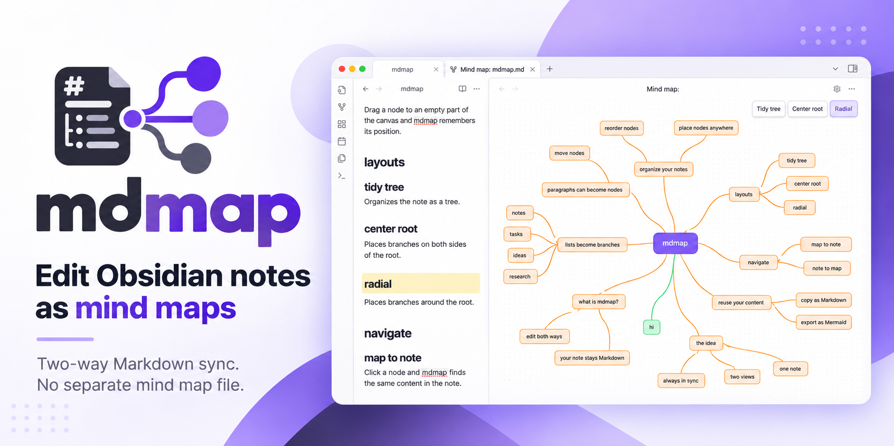
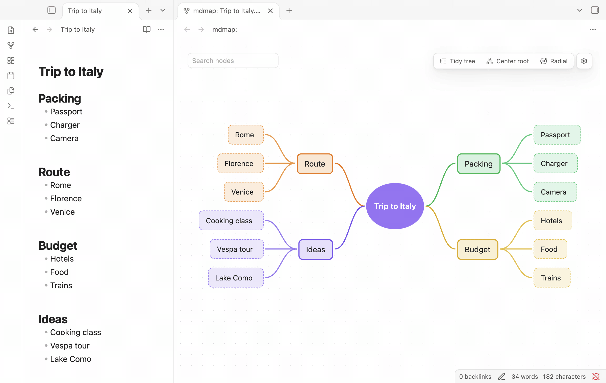

# mdmap

Edit Obsidian notes as mind maps.

Changes in the map are written to the note, and changes in the note show up
in the map. The Markdown note is the only place the content is stored; there
is no separate mind map file.



[Install](#install) · [Features](#features) · [Issues](https://github.com/pererinha/mdmap/issues) · [Changelog](CHANGELOG.md) · [Sponsor](https://github.com/sponsors/pererinha)

## Features

- **Headings, list items and paragraphs as nodes.**
- **Two-way sync.** Edit the map and the note changes; edit the note, in
  Obsidian or another app, and the map updates.
- **Drag and drop.** Drag a node onto another node to change its parent, or
  to an empty part of the map to keep it there.
- **Automatic layouts.** *Tidy tree*, *Center root* and *Radial* place every
  node without overlaps.
- **From the map to the note and back.** Click a node to highlight its line
  in the note; put the cursor on a heading in the note to select its node.
- **Collapse and expand.** Hide the nodes under a node and show them again.
  Collapsing a heading or a list item folds it in the note, and folding it in
  the note collapses the node. The map remembers each note's collapsed nodes.
- **Colors.** Change the colors of the center, its text, the branches and the
  levels under each branch, separately for the light and the dark theme.
  Until you do, the map follows Obsidian's theme.
- **Search.** Type in the field at the top of the map, or press Cmd+F, to
  highlight the nodes that contain the text and jump from one to the next.
- **Copy a branch as Markdown**, exactly as it is written in the note.
- **Mermaid export.** Copy the whole note as a Mermaid `mindmap` block.
- **Images and videos** embedded in the note are shown inside their node.
- **Undo and redo** for changes made in the map, including a node dragged to
  a new place and a layout button, with the keyboard or the buttons under the
  layout buttons.
- **Lock.** The lock next to undo and redo stops the map from changing the
  note: no editing, dragging or layouts until you open it again. It is open by
  default, and the map remembers it.
- **In Obsidian's language.** Brazilian Portuguese is the first translation;
  other languages show English.

## How it works

This note:

```markdown
# Trip

## Packing
- Passport
- Charger

## Plan
Leave early to beat the traffic.

Keep the receipts.

Stops:
1. Lyon
2. Turin
```

becomes this map:

```
Trip
├── Packing
│   ├── Passport
│   └── Charger
└── Plan
    ├── Leave early to beat the traffic.   (both paragraphs, one node)
    └── Stops:
        ├── Lyon
        └── Turin
```

Add a child named *USB-C cable* under *Charger* in the map, and the note
gets it as a nested item:

```markdown
- Charger
  - USB-C cable
```

- The heading level sets how deep a node is. When you move a node, the
  plugin updates the heading levels of the node and everything under it.
- If a note has more than one top-level heading, the map adds a root node
  named after the file.
- Paragraphs that follow one another are one node, which shows the whole
  text with Markdown formatting. Images stack inside the paragraph's box.
  Click the text to edit its Markdown source. A list right after a paragraph
  becomes that paragraph's children.
- Tables, code blocks, quotes and embeds belong to the node before them and
  move with it.
- A node shows the first line of its content under its title.

## Install

1. In Obsidian, open **Settings → Community plugins**, select **Browse**,
   search for *mdmap* and select **Install**, then **Enable**.
2. Open a note and run **Edit current note as mind map** from the command
   palette. The map opens next to the note.

To install it by hand, download `main.js`, `manifest.json` and `styles.css`
from a [release](https://github.com/pererinha/mdmap/releases) into
`<vault>/.obsidian/plugins/mdmap/`, or build them from the source code
directly into the vault (see [Development](#development)), and turn on
*mdmap* in **Settings → Community plugins**.

## Keyboard and mouse

| Action | Input |
|---|---|
| Edit a node's text | Click where the caret should go and type in the node itself; click outside, or press Escape to finish and keep the node selected for the keys below (Cmd+Z then undoes it). In a paragraph, Enter and Shift+Enter add a line |
| Add a child | Tab |
| Add a sibling | Enter |
| Delete | Delete or Backspace |
| Move up or down among siblings | Alt+Up / Alt+Down |
| Move to another parent | Drag the node, or the dot on the side its edge comes in, onto the new parent |
| Collapse or expand the nodes under a node | Space on the selected node, or click the dot on the side its children leave from |
| Place a node anywhere | Drag the node to an empty part of the map; the nodes under it move with it |
| Copy a node and the nodes under it as Markdown | Hover over the node and click the copy icon in its corner |
| Undo / redo | Cmd+Z / Cmd+Shift+Z (Ctrl on Windows and Linux), or the arrows under the layout buttons |
| Lock or unlock the map | Click the lock under the layout buttons. While it is closed, you can still move around, zoom, search, collapse, copy and click a node to see it in the note |
| Search the map | Cmd+F (Ctrl on Windows and Linux) or click the search field, type; Enter / Shift+Enter center the next / previous match, Escape clears |
| Move around the map | Scroll with two fingers on a trackpad or with the mouse wheel, or drag an empty part of the map |
| Zoom | Pinch on a trackpad, or Cmd+scroll (Ctrl on Windows and Linux) |

The command **Copy current note as Mermaid mindmap** copies the whole note to
the clipboard as a Mermaid `mindmap` block.

## Settings and details

**Settings.** The gear next to the layout buttons in the map has *Show
paragraphs*, *Show clicked node in the note* and the colors. *Settings →
mdmap* has them too, and two more.

- **List items and paragraphs as nodes** (on by default, only in *Settings →
  mdmap*). When it is off, only headings are nodes, and list items and
  paragraphs belong to the heading above them. The change applies the next
  time you open a mind map.
- **Show paragraphs** (on by default). When it is off, paragraphs are not
  nodes and their text stays in the heading above them; the note does not
  change. It needs *List items and paragraphs as nodes*.
- **Show clicked node in the note** (on by default). When it is off,
  clicking a node does not show it in the note.
- **Mind map width** (50 % by default, only in *Settings → mdmap*). The
  map's share of the window, from 20 to 80 %, when it opens next to the note.
- **Colors.** One tab for the light theme and one for the dark theme, each
  with the center and six palette colors, which the top-level branches take
  in turn; after the sixth they start over, 25 % closer to white each round.
  Click the center to see the color of its text, or a palette color to see
  its three shades: the branch's children take the first, their children the
  second, and every level further down the third. *Edit* unlocks a color
  picker and a field for the hex; *Use theme colors* goes back to the
  theme's.

**Where positions are saved.** When you drag a node to an empty part of the
map, the plugin adds a comment block at the end of the note:

```
%% mindmap-positions
Pesquisa/Artigos: -54,149
%%
```

Each line has the node's path (the titles from the root down, separated by
`/`) and its x,y distance from the top-left corner of its parent, so the
node stays next to its parent when the parent moves. Obsidian hides `%%`
comments in reading view. The plugin deletes the block when no node has a
saved position, for example after you click *Tidy tree*.

**Images and videos from the internet.** If an embedded image or video links
to an `http://` or `https://` address, the plugin downloads it from that
address when it shows the node, so the server at that address receives a
request from your computer. Images and videos stored in the vault are read
from the vault.

## Support mdmap

If mdmap is useful to you, you can support its development on [GitHub Sponsors](https://github.com/sponsors/pererinha).

## Development

```sh
git clone https://github.com/pererinha/mdmap.git
cd mdmap
npm install
npm run build     # builds main.js and styles.css; with MDMAP_VAULT=/path/to/vault it also copies the plugin into that vault
npm test          # unit tests for reading and writing Markdown, the layouts, the Mermaid export, the colors and the translations
```

To run tests in a real Obsidian app, see [e2e/README.md](e2e/README.md).

## Release

1. Set the new version in `manifest.json` and `package.json`, and describe
   the changes in [CHANGELOG.md](CHANGELOG.md).
2. Start the test Obsidian and the Android emulator, and run `e2e/all.sh`
   (see [e2e/README.md](e2e/README.md)). Every scenario must exit with 0, and
   the only false checks must be the two expected ones listed there.
3. Push a tag with exactly that version and no `v` (`1.0.1`, not `v1.0.1`).
   Obsidian finds the release by this name.
4. The [release workflow](.github/workflows/release.yml) runs the tests,
   builds the plugin, and publishes `main.js`, `manifest.json` and
   `styles.css` in a GitHub release named after the tag.

## License

MIT, see [LICENSE](LICENSE). Built with [React Flow](https://reactflow.dev);
the licenses of the packages included in the build are in
[THIRD_PARTY_LICENSES.md](THIRD_PARTY_LICENSES.md).
